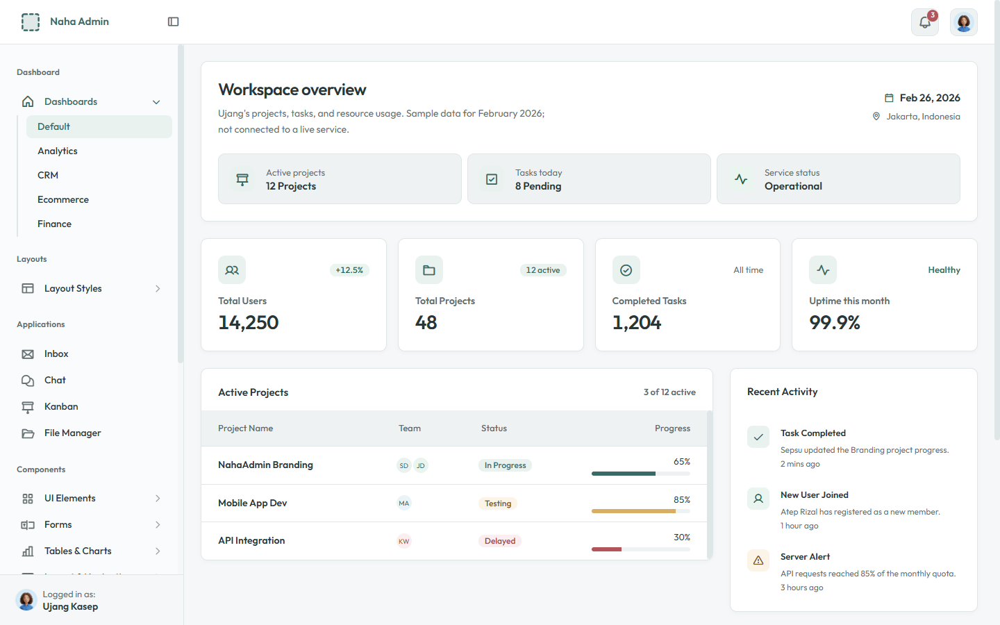

<div align="center">

# NahaAdmin

**A calmer starting point for your next admin dashboard.**

Soft colors. Consistent components. Plain HTML, CSS, and jQuery.
Built with Bootstrap 5 — no build step required.

[](https://getbootstrap.com/)
[](LICENSE)

[Live demo](https://naha-admin.vercel.app/demo/) · [Documentation](https://naha-admin.vercel.app/docs/) · [Download](https://github.com/sepsu-dev/naha-admin/releases)

[](https://naha-admin.vercel.app/demo/)

</div>

---

## Built to be edited

NahaAdmin gives internal tools, admin panels, and prototypes a consistent foundation without a frontend toolchain. Keep the pages you need, edit the markup, and connect your own backend.

| Included | What you get |
| --- | --- |
| Soft, shared theme | Cool neutral surfaces, muted teal accents, Outfit typography, and restrained shadows |
| 5 dashboards | Default, Analytics, CRM, E-Commerce, and Finance with sample data |
| 66 component destinations | Dedicated examples, variants, and interactive states in the demo sidebar |
| Application layouts | Inbox, chat, kanban, and file manager examples |
| Essential pages | Login, registration, password reset, profiles, error pages, and starter layouts |
| Shared navigation | Active links, desktop sidebar persistence, mobile sidebar, and keyboard controls |
| Forms and data | Native validation, advanced selects, editors, ECharts, DataTables, and Grid.js examples |
| Open source | MIT licensed; no required npm install or build step |

Bootstrap **5.3.8** powers the grid and components. Phosphor icons ship in six weights.

This is a frontend template, not a working admin application. Dashboards use sample data.
Auth examples validate input locally; they do not sign users in, create accounts, or send email.
Inbox, chat, file manager, and other app examples need your own backend for persistence and live data.

---

## Quick start

```bash
# Clone the repository
git clone https://github.com/sepsu-dev/naha-admin.git
cd naha-admin
```

Open `index.html` directly in your browser, or double-click it in your file manager.
Open `demo/index.html` for examples or `docs/index.html` for documentation.
No local server, package installation, or build step is required. Keep the project folders together so relative asset paths work.
Some examples load third-party assets from CDNs and need an internet connection.

---

## Find your starting point

| Need | Open locally |
| --- | --- |
| Browse dashboards | [`demo/index.html`](demo/index.html) |
| Find a component | **Components** menu in [`demo/index.html`](demo/index.html) |
| Start with navigation | [`demo/starter.html`](demo/starter.html) |
| Start with a minimal page | [`demo/blank.html`](demo/blank.html) |
| Adjust theme and layout | [`docs/theme-layout.html`](docs/theme-layout.html) |

## Project structure

```text
naha-admin/
├── assets/
│   ├── images/       # Logos, banners, user avatars, and UI graphics
│   ├── plugins/      # Third-party libraries (Bootstrap, Phosphor, NProgress, etc.)
│   ├── scripts/      # Shared layout script and page-specific initializers
│   └── styles/       # Shared theme, landing styles, and page styles
├── demo/             # Static HTML pages and component examples
├── docs/             # Static documentation site
├── CONTRIBUTING.md   # Editing and validation workflow
├── CHANGELOG.md      # Changes since the last release
├── index.html        # Landing page
├── robots.txt        # Web crawler configuration
└── sitemap.xml       # Search engine sitemap
```

---

## Make it yours

Start from `demo/starter.html` for the shared navbar/sidebar, or `demo/blank.html` for a minimal page.
Keep relative asset paths valid if moving a page to another directory.

Edit `assets/styles/naha-admin.css` and `assets/scripts/naha-admin.js` as the source files.
After editing, copy each source file's contents to its matching `.min.css` or `.min.js` file used by the examples.

These `.min` files are compatibility copies, not compressed builds. This avoids a required npm toolchain.
Do not edit both copies separately. See [contributing](CONTRIBUTING.md) for browser checks.

Theme colors live in the shared CSS. Update `--primary`, its `--nd-primary-rgb` alias,
and both interaction shades together when changing the brand color:

```css
:root {
  --primary: #386b65;
  --nd-primary-rgb: 56, 107, 101;
  --nd-primary-light: #56877f;
  --nd-primary-dark: #2e5954;
}
```

Use the existing tokens for new components rather than adding page-specific colors.
Typography, spacing, radius, focus rings, and shadows also live in the shared theme.
The shipped theme is light-only; chart colors and vendor themes may need separate changes.

## Component examples

Open `/demo/index.html` and use the **Components** sidebar groups.
Each of the 66 components has a dedicated page; variants and states stay together there.
Existing combined form demos remain available for compatibility.
Navs demonstrates page links; Tabs demonstrates keyboard-accessible panels.
Tabs & Accordions combines both controls in a project workspace. Combined forms
show project requests, notification preferences, and delivery choices; submissions
are checked locally, never sent or saved.
AI Elements, Blocks, and community registries are outside this collection.
This is Bootstrap HTML, not shadcn React API compatibility.

New demos use `assets/styles/pages/components.css` and `assets/scripts/pages/components.js`.
Reuse their markup and handlers together. Native controls cover validation, OTP paste,
file selection, direction, and popovers; Bootstrap owns modal/offcanvas focus and dismissal.
Modern browsers with the Popover API are required for the new popover/context-menu examples.
Calendar and resizable panels include keyboard controls. Component behavior is not a promise
of full feature parity with each upstream React primitive.

Attachments stay local (5 MB limit); chat replies and trace output are simulated.
Questionnaire, profile, and project changes are in-memory and reset on reload.
Message scrolling preserves reading position for incoming content and earlier history;
full streaming/virtualized transcript infrastructure is not included.

## Contribute

Found a layout issue or missing state? Include the page URL, browser, viewport width,
and reproduction steps in your issue. Focused pull requests are welcome.
See [CONTRIBUTING.md](CONTRIBUTING.md) for the editing workflow and [CHANGELOG.md](CHANGELOG.md) for recent changes.

## Dependencies and network access

Bootstrap, jQuery, Phosphor, SimpleBar, NProgress, Animate.css, ECharts, Select2,
SweetAlert2, and Tempus Dominus are bundled under `assets/plugins/`.
Load jQuery before the shared layout script and jQuery plugins, and load vendors before page initializers.

Some examples use CDNs: DataTables, Grid.js, Quill, CKEditor, Summernote, Leaflet,
Notyf, SortableJS, and flag icons. Google Fonts also requires a connection; system fonts are the fallback.
For offline use, self-host the assets used by your chosen pages, pin versions, and retain vendor license notices.
Map tiles and external images can require network access too.

## License

Released under the [MIT License](LICENSE). Personal, client, and commercial use is allowed.
No visible UI attribution is required. Retain the copyright and license notice in copies or substantial portions.
Third-party libraries retain their own licenses; review those for your application.